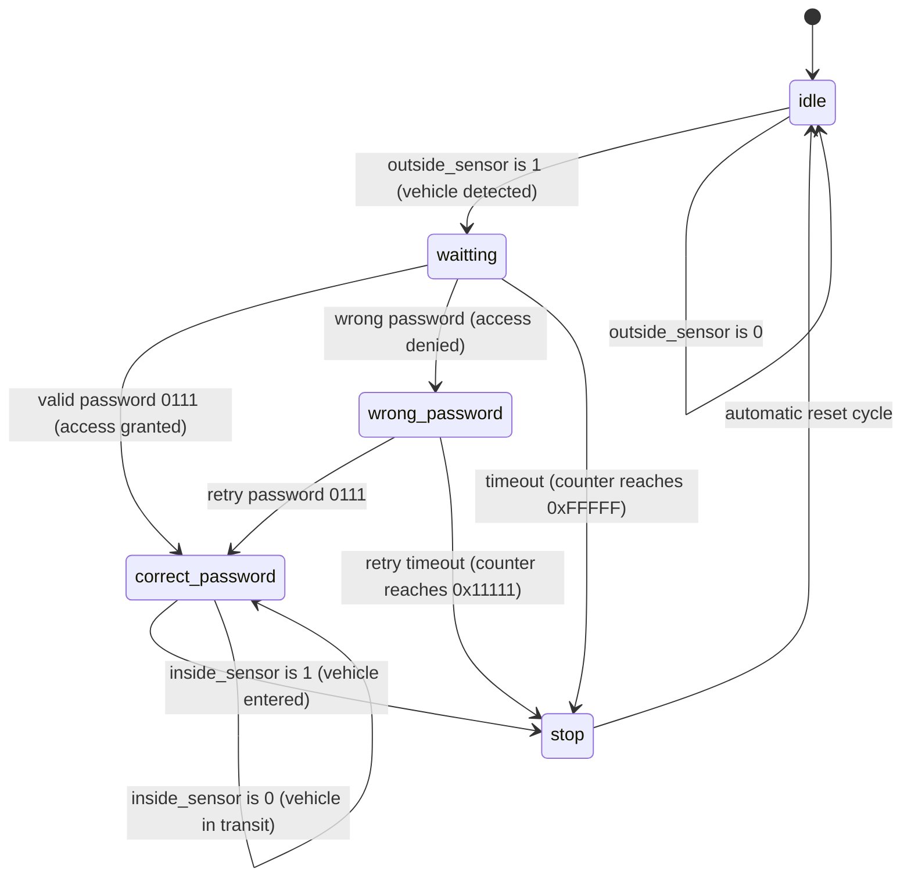

# Smart Parking Security Controller with FSM Interlocks (VHDL)

An automated parking barrier gate access controller modeled in VHDL. Utilizes a deterministic 5-state Moore Finite State Machine (FSM) to supervise vehicle sensing, 4-bit passcode authentication, timeout countdowns, and visual access indicators.

---

## Finite State Machine (FSM) State Transition Diagram



---

## Hardware Port Specifications

| Signal Name | Direction | Width | Description |
| :--- | :--- | :--- | :--- |
| `clk` | Input | 1-bit | Master system clock |
| `reset` | Input | 1-bit | Asynchronous active-low system reset |
| `outside_sensor` | Input | 1-bit | Vehicle presence sensor at the outer entry gate |
| `inside_sensor` | Input | 1-bit | Vehicle presence sensor inside parking premises |
| `password` | Input | 4-bit | Parallel security passcode input (`0111` grants entry) |
| `green_light` | Output | 1-bit | Active-high barrier open indicator / entry granted |
| `red_light` | Output | 1-bit | Active-high barrier locked indicator / access denied |

---

## Output Logic Table (Moore Model)

The controller follows a strict Moore model where outputs depend solely on the registered `current_state` (ensuring glitch-free actuation):

| Current State | `green_light` | `red_light` | Status Description |
| :--- | :---: | :---: | :--- |
| `idle` | `0` | `0` | Gate closed; system in baseline standby |
| `waitting` | `0` | `0` | Vehicle detected; awaiting passcode input |
| `correct_password` | `1` | `0` | Passcode validated; barrier open for transit |
| `wrong_password` | `0` | `1` | Authentication failed; retry window active |
| `stop` | `0` | `0` | Vehicle cleared or session timed out; re-arming |

---

## Key Hardware Design Features

1. **Deterministic 5-State Moore Architecture:** Decouples asynchronous inputs from physical gate actuators to guarantee glitch-free signaling and prevent motor chatter.
2. **Integrated Hardware Countdown Timer:** Employs a 33-bit hardware counter to enforce non-blocking timeouts (`0xFFFFF` for password entry, `0x11111` for retry), preventing system lockouts caused by abandoned vehicles.
3. **Dual-Sensor Interlocking:** Ensures the barrier remains open until `inside_sensor = '1'` asserts that the vehicle has completely traversed the gate perimeter before resetting to `idle`.

---

## Directory Structure

```
├── car_parking_sys.vhd   # Synthesizable VHDL FSM Controller
└── README.md             # Architecture documentation and state diagrams
```
